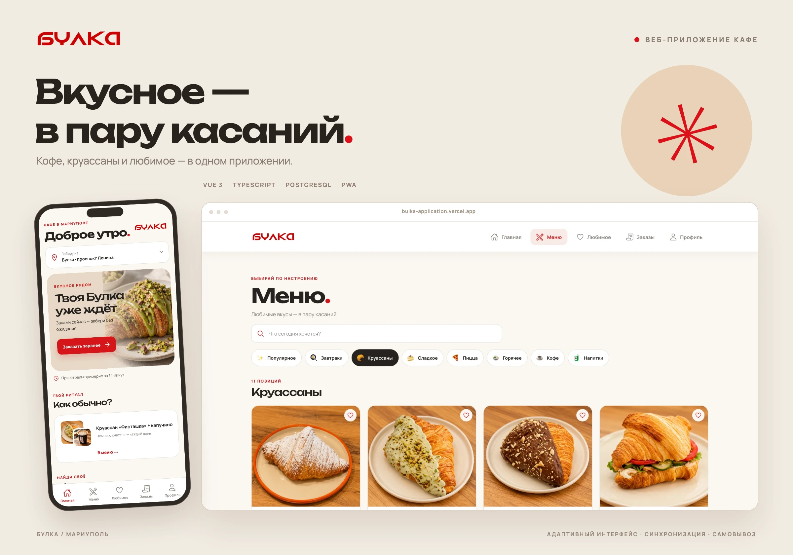
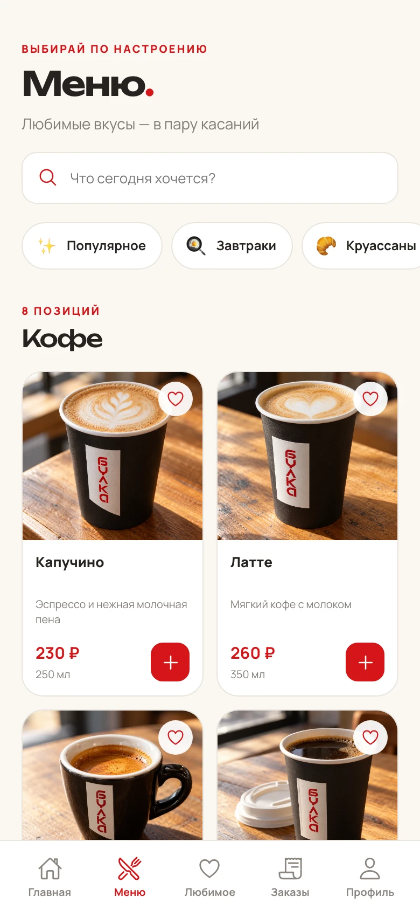
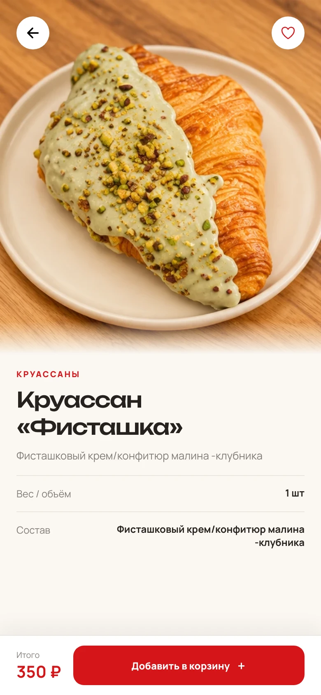
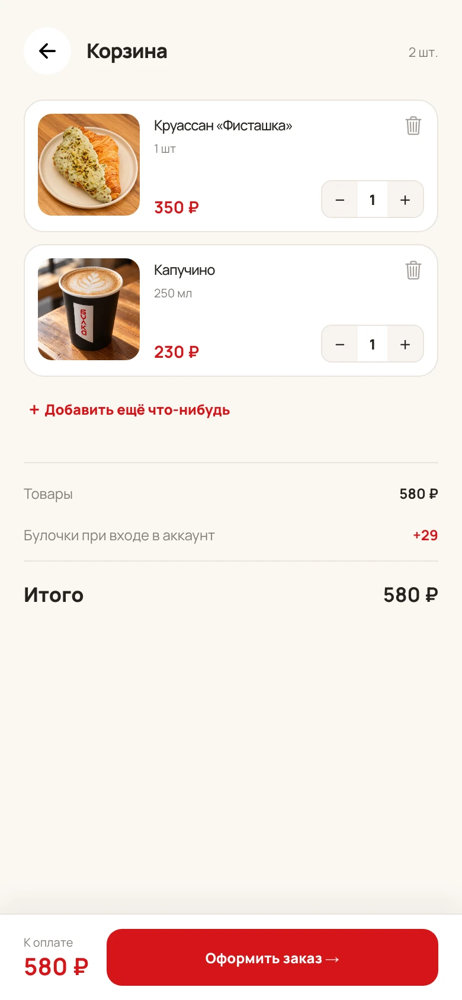
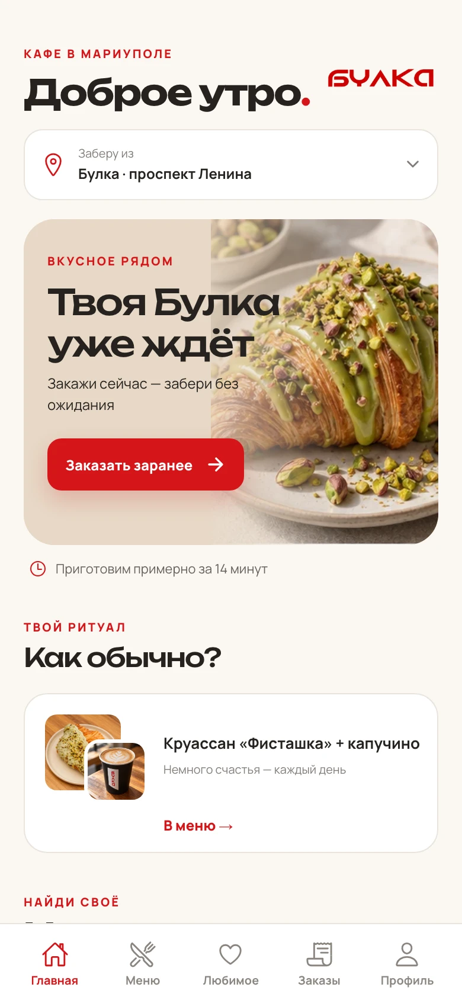
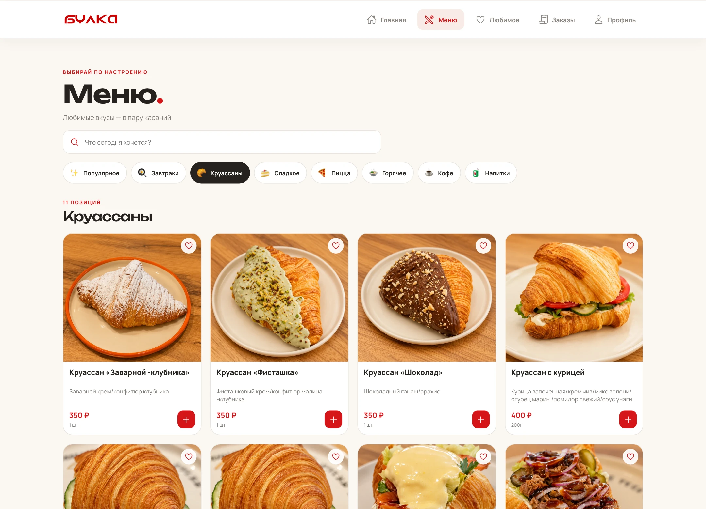
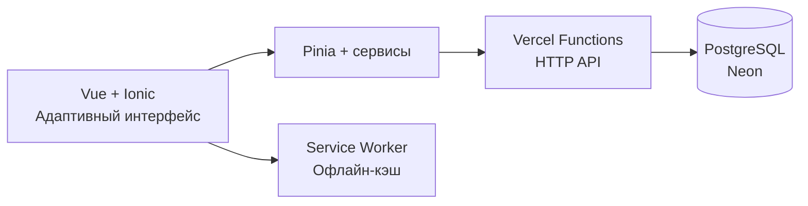

<div align="center">


# Булка

**Вкусное — в пару касаний.**

Full-stack приложение кафе: меню, самовывоз и любимые вкусы на любом устройстве.

[Открыть приложение ↗](https://bulka-application.vercel.app/) · [Скриншоты](#скриншоты) · [Технологии](#технологии) · [Документация](./docs/DEVELOPMENT.md)

<p>


</p>

</div>



## О проекте

«Булка» объединяет заказ еды и личный кабинет в одном приложении. Гость может выбрать кофе и круассан, собрать корзину и оформить самовывоз. После входа история заказов, избранное и программа лояльности доступны на других устройствах.

Визуальная основа — тёплый фон, красные акценты, крупная типографика и фотографии блюд. Интерфейс адаптирован для телефона, планшета и компьютера; на iPhone его можно добавить на экран «Домой».

| Выбрать                               | Заказать                                            | Вернуться                                    |
| :------------------------------------ | :-------------------------------------------------- | :------------------------------------------- |
| 55 позиций, категории и поиск по меню | Самовывоз, выбор времени, заказ с аккаунтом или без | Любимые товары, история и бонусные «булочки» |

## Скриншоты

Реальные экраны работающего приложения.

<table>
  <tr>
    <th align="center">Меню и категории</th>
    <th align="center">Карточка блюда</th>
    <th align="center">Корзина</th>
  </tr>
  <tr>
    <td width="33%" align="center"></td>
    <td width="33%" align="center"></td>
    <td width="33%" align="center"></td>
  </tr>
</table>

<details>
<summary><b>Ещё экраны: главная и меню на компьютере</b></summary>

<br />

<p align="center"></p>



</details>

## Возможности

- **Меню с поиском.** Категории, состав, фотографии, варианты и добавки к товарам.
- **Самовывоз без обязательной регистрации.** Корзина, выбор точки и времени получения, оплата при получении.
- **Личный кабинет.** Регистрация по почте и паролю, редактирование профиля и синхронизация истории заказов.
- **Избранное с понятным приоритетом.** Без входа — список устройства; после входа — список аккаунта. При регистрации любимое переносится в новый аккаунт.
- **Программа лояльности.** 5% булочками после подтверждения получения и оплаты; списание до 30% суммы следующего заказа.
- **PWA.** Установка на главный экран, открытие сохранённых страниц без сети и обновления с сохранением корзины и избранного.

## Технологии

| Слой               | Решение                                     |
| :----------------- | :------------------------------------------ |
| Интерфейс          | Vue 3 · TypeScript · Ionic Vue · Vue Router |
| Состояние и данные | Pinia · сервисный слой · кэш устройства     |
| Сервер             | Node.js · Vercel Functions · HTTP API       |
| База данных        | PostgreSQL · Neon · SQL-транзакции          |
| Сборка и PWA       | Vite · Workbox · Service Worker             |
| Мобильная оболочка | Capacitor · iOS-проект                      |
| Доставка           | GitHub → автоматическая публикация в Vercel |

### Как устроено приложение



### Инженерные решения

**Заказ проверяется сервером.** Цена, варианты и добавки рассчитываются по каталогу на стороне API. Повторная отправка одного заказа не создаёт дубль.

**Булочки списываются атомарно.** Изменение баланса и сохранение заказа выполняются в одной транзакции. Одновременное оформление с двух устройств не позволяет потратить один баланс дважды; повторное подтверждение оплаты не дублирует начисление.

**Аккаунты изолированы.** Пароли хранятся как scrypt-хеши, сессии — в защищённых HttpOnly-cookie. Данные аккаунта отделены от гостевых, а запоздавшие ответы сервера не восстанавливают профиль после выхода.

**Обновления учитывают сохранённое состояние.** Приложение предлагает установить новую версию; переход со старого кэша сохраняет корзину и избранное и не прерывает оформление заказа.

## Локальный запуск

Для разработки используется Node.js 24.

```bash
git clone https://github.com/chikbob/bulka-application.git
cd bulka-application
npm ci
npm run dev
```

Так запускается интерфейс. Для входа, синхронизации и оформления заказов нужны API и PostgreSQL — настройка окружения, миграции и запуск через `vercel dev` описаны в [руководстве разработчика](./docs/DEVELOPMENT.md#разработка).

<details>
<summary><b>Проверки, структура и серверные интеграции</b></summary>

### Проверки

```bash
npm run lint
npm run typecheck
npm run build
node --test scripts/auth-session.test.mjs scripts/pwa-migration.test.mjs
```

Интеграционные тесты дополнительно проверяют вход с двух устройств, изоляцию аккаунтов, гостевое оформление, серверные цены, повторную отправку заказа и одновременное списание бонусов. [Как их запустить →](./docs/DEVELOPMENT.md#проверки)

### Структура

```text
src/
├── components/     Переиспользуемые компоненты
├── views/          Экраны приложения
├── stores/         Состояние и кэш аккаунта / устройства
├── services/       Обращения к HTTP API
├── router/         Маршруты
├── data/           Каталог и контент
└── styles/         Дизайн-система и адаптивные стили
api/                Серверная функция и маршруты API
server/             PostgreSQL, сессии, пароли и схема БД
scripts/            Миграции и проверки
ios/                Проект Capacitor для iOS
docs/               Документация и скриншоты
```

### Границы интеграции

Заказы сохраняются в PostgreSQL. Для обработки сотрудниками предусмотрен защищённый API смены статусов. Подключение кассы, уведомлений кафе, онлайн-оплаты и восстановления пароля по почте — следующие этапы развития. Текущий сценарий предусматривает оплату при получении.

Каталог основан на материалах кафе; небольшие исходные фото восстановлены для карточек, кофейная карта добавлена отдельно. Подробнее об источниках и подготовке к работе кафе — в [документации](./docs/DEVELOPMENT.md).

</details>

## На главном экране iPhone

Открой [приложение](https://bulka-application.vercel.app/) в Safari → **Поделиться → На экран «Домой» → Добавить**. Включи «Открывать как веб-приложение», если Safari предлагает этот переключатель.

Для первого запуска, оформления заказа и синхронизации нужен интернет. Просмотренные страницы и фотографии доступны из офлайн-кэша.

---

<div align="center">

**Булка · Мариуполь**

[Приложение ↗](https://bulka-application.vercel.app/) · [Документация](./docs/DEVELOPMENT.md) · [GitHub](https://github.com/chikbob)

</div>
